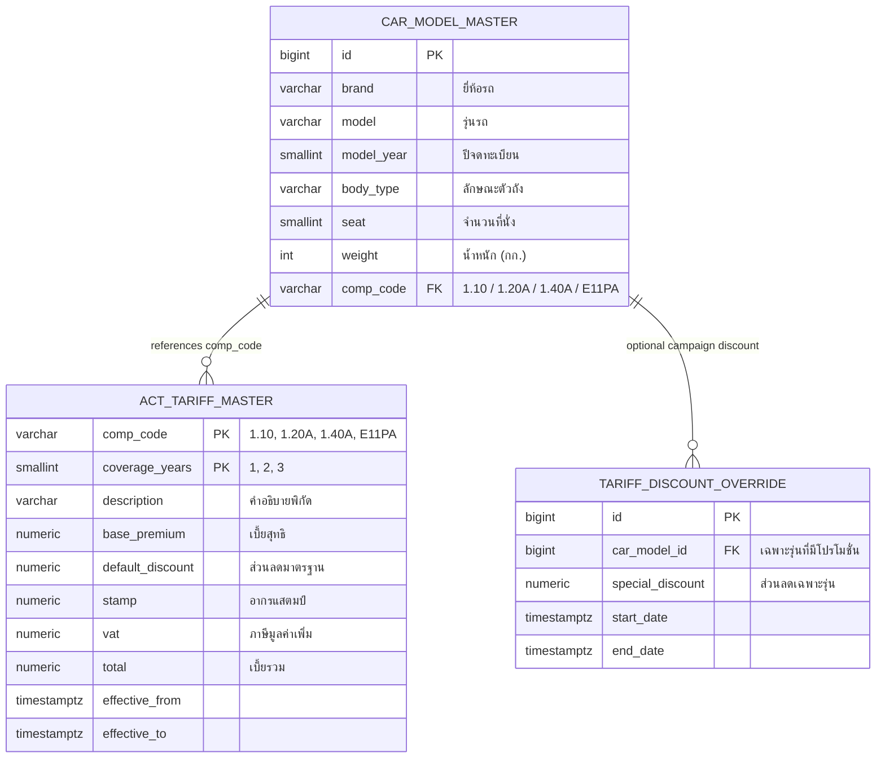
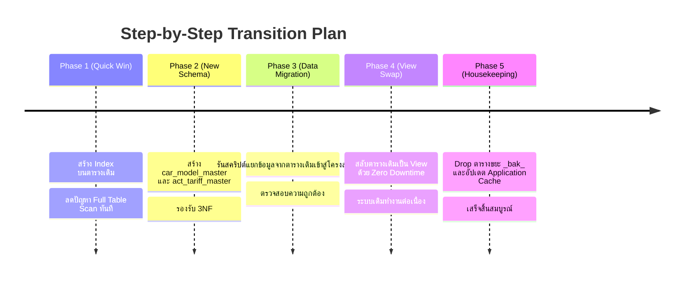

# สถาปัตยกรรมการปรับปรุงตาราง Imp_Discount_Premium (Senior-Level Architecture)
# Imp_Discount_Premium Optimization & Normalization Architecture Design

- **Author / ผู้วิเคราะห์**: Senior Software & Database Architect
- **Date / วันที่**: 2026-09-08
- **Scope / ขอบเขต**: `insurverse."Imp_Discount_Premium"` และระบบการคิดเบี้ย พ.ร.บ. (Compulsory Motor Insurance)

---

## 📌 1. บทสรุปผู้บริหาร / Executive Summary

| ภาษาไทย (🇹🇭) | English (🇬🇧) |
|---|---|
| ตาราง `Imp_Discount_Premium` ปัจจุบันมีลักษณะเป็นตารางแบน (Denormalized Flat Table) ที่รวมข้อมูลสเปกรถยนต์และตัวเลขเบี้ย พ.ร.บ. ไว้ด้วยกัน ส่งผลให้ตัวเลขเงิน (`Premium`, `Stamp`, `Vat`, `Total`) ของรหัส `Comp_Code` ทั้ง 4 แบบถูกเก็บซ้ำซ้อนหลายหมื่นแถว ไม่มี Primary Key ไม่มี Index และมีการคัดลอกตารางสำรอง (`_bak_...`) มากมาย แนวทางแบบ Senior คือการทำ Normalization (3NF) แยกสเปกรถออกจากพิกัดเบี้ย เหลือตารางเบี้ยเพียง 4 แถว และสร้าง View จำลองตารางเดิมเพื่อให้ระบบทำงานต่อได้แบบ Zero-Downtime | The current `Imp_Discount_Premium` table is a denormalized flat table combining car specifications and statutory tariff rates. This causes identical monetary values (`Premium`, `Stamp`, `Vat`, `Total`) across the 4 primary `Comp_Code`s to be duplicated tens of thousands of times without primary keys or indexes, accompanied by ad-hoc backup tables (`_bak_...`). The senior-level architecture normalizes the design (3NF), reducing the tariff matrix to just 4 master rows, coupled with a backward-compatible view for zero-downtime adoption. |

---

## 🔍 2. ปัญหาเชิงเทคนิคในปัจจุบัน / Current Technical Debt & Anti-Patterns

1. **การซ้ำซ้อนของข้อมูลเบี้ย (Financial Duplication)**:
   - รหัส `Comp_Code` ตามมาตรฐาน คปภ. หลัก ๆ มีเพียง 4 พิกัด ได้แก่:
     - `1.10`: รถยนต์นั่งส่วนบุคคลไม่เกิน 7 ที่นั่ง (Sedan / Usage 110)
     - `1.20A`: รถยนต์โดยสารส่วนบุคคลเกิน 7 ที่นั่ง (Van / Usage 210)
     - `1.40A`: รถยนต์บรรทุกส่วนบุคคล (Pickup / Truck / Usage 320)
     - `E11PA`: รถยนต์ไฟฟ้าส่วนบุคคล (EV Sedan)
   - แต่ระบบกลับเก็บตัวเลขเงินเหล่านี้ซ้ำกันมากกว่า 20,000 - 50,000 แถวตามจำนวนรุ่นรถยนต์
2. **ไม่มี Primary Key และไม่มี Unique Constraint**:
   - ข้อมูลเกิด Duplicate ได้ง่าย ทำให้ Stored Procedure เกือบทุกตัวต้องสั่ง `SELECT DISTINCT`
3. **ไม่มี Index (Zero B-Tree Indexes)**:
   - การสืบค้นใน API (`hbdisv.go`, `act.controller.js`) และฟังก์ชันในฐานข้อมูลทำ Full Table Scan ทุกครั้ง
4. **Data Type ไม่เหมาะสม**:
   - คอลัมน์ `"Year"` เป็น `VARCHAR(255)` แทนที่จะเป็น `SMALLINT`
   - ตัวเลขเงินไม่มีการระบุ Precision/Scale ชัดเจน
5. **Table Sprawl & Clutter**:
   - มีตาราง Clone ชั่วคราวค้างในฐานข้อมูล เช่น `imp_discount_premium_20260703`, `imp_discount_premium_160226`, `Imp_Discount_Premium_bak_20260630` ขาดกระบวนการ Audit Trail และ Version Control

---

## 🏛️ 3. สถาปัตยกรรมเป้าหมาย (Target Architecture - 3NF)



---

## 💻 4. โครงสร้าง Database DDL (Schema Definition)

### 4.1 ตารางพิกัดเบี้ยหลัก (Act Tariff Master - เพียง 4 แถว)

```sql
CREATE TABLE insurverse.act_tariff_master (
    comp_code           VARCHAR(20) NOT NULL,
    coverage_years      SMALLINT NOT NULL DEFAULT 1,
    description         VARCHAR(100) NOT NULL,
    base_premium        NUMERIC(12, 2) NOT NULL,
    default_discount    NUMERIC(12, 2) NOT NULL DEFAULT 0.00,
    stamp               NUMERIC(12, 2) NOT NULL,
    vat                 NUMERIC(12, 2) NOT NULL,
    total               NUMERIC(12, 2) NOT NULL,
    effective_from      TIMESTAMPTZ NOT NULL DEFAULT CURRENT_TIMESTAMP,
    effective_to        TIMESTAMPTZ NOT NULL DEFAULT '9999-12-31 23:59:59+07',
    is_active           BOOLEAN NOT NULL DEFAULT TRUE,
    created_at          TIMESTAMPTZ NOT NULL DEFAULT CURRENT_TIMESTAMP,
    PRIMARY KEY (comp_code, coverage_years, effective_from)
);

-- ข้อมูลตั้งต้นพิกัด คปภ. (Single Source of Truth)
INSERT INTO insurverse.act_tariff_master 
(comp_code, coverage_years, description, base_premium, default_discount, stamp, vat, total)
VALUES
('1.10',  1, 'รถยนต์นั่งส่วนบุคคลไม่เกิน 7 คน (Sedan)',  600.00,  0.00, 3.00, 42.21, 645.21),
('1.20A', 1, 'รถยนต์โดยสารส่วนบุคคลเกิน 7 คน (Van)',   1100.00,  0.00, 5.00, 77.35, 1182.35),
('1.40A', 1, 'รถยนต์บรรทุกส่วนบุคคล (Pickup)',           900.00,  0.00, 4.00, 63.28, 967.28),
('E11PA', 1, 'รถยนต์นั่งส่วนบุคคลไฟฟ้า (EV)',            600.00,  0.00, 3.00, 42.21, 645.21)
ON CONFLICT DO NOTHING;
```

### 4.2 ตารางสเปกรถยนต์ (Car Model Master)

```sql
CREATE TABLE insurverse.car_model_master (
    id                  BIGSERIAL PRIMARY KEY,
    brand               VARCHAR(100) NOT NULL,
    model               VARCHAR(150) NOT NULL,
    model_year          SMALLINT NOT NULL,
    body_type           VARCHAR(50),
    doors               SMALLINT DEFAULT 0,
    seat                SMALLINT DEFAULT 0,
    weight              INTEGER DEFAULT 0,
    car_group           VARCHAR(50),
    car_type            SMALLINT,
    sedan               VARCHAR(50),
    comp_code           VARCHAR(20) NOT NULL,
    created_at          TIMESTAMPTZ NOT NULL DEFAULT CURRENT_TIMESTAMP,
    updated_at          TIMESTAMPTZ NOT NULL DEFAULT CURRENT_TIMESTAMP,
    CONSTRAINT uq_car_model_spec UNIQUE (UPPER(brand), UPPER(model), model_year, COALESCE(body_type, ''))
);

-- Composite Index สำหรับการค้นหาเบี้ยที่รวดเร็ว (Sub-millisecond Search)
CREATE INDEX idx_car_model_lookup 
ON insurverse.car_model_master (UPPER(brand), UPPER(model), model_year, body_type);

CREATE INDEX idx_car_model_comp_code 
ON insurverse.car_model_master (comp_code);
```

### 4.3 ตารางแคมเปญส่วนลดพิเศษเฉพาะรุ่น (Campaign Override)

```sql
CREATE TABLE insurverse.tariff_discount_override (
    id                  BIGSERIAL PRIMARY KEY,
    car_model_id        BIGINT NOT NULL REFERENCES insurverse.car_model_master(id) ON DELETE CASCADE,
    special_discount    NUMERIC(12, 2) NOT NULL,
    start_date          TIMESTAMPTZ NOT NULL,
    end_date            TIMESTAMPTZ NOT NULL,
    is_active           BOOLEAN NOT NULL DEFAULT TRUE,
    created_at          TIMESTAMPTZ NOT NULL DEFAULT CURRENT_TIMESTAMP
);

CREATE INDEX idx_tariff_override_lookup 
ON insurverse.tariff_discount_override (car_model_id, start_date, end_date) 
WHERE is_active = TRUE;
```

---

## 🛡️ 5. สะพานเชื่อมแบบไม่กระทบระบบเดิม (Zero-Downtime Compatibility View)

แทนที่จะแก้โค้ดและ Stored Procedures ทั้งหมด ให้สร้าง **View** ที่ชื่อเหมือนตารางเดิม:

```sql
CREATE OR REPLACE VIEW insurverse."Imp_Discount_Premium" AS
SELECT 
    c.brand AS "Brand",
    c.model AS "Model",
    c.model_year::text AS "Year",
    c.doors AS "Doors",
    c.seat AS "Seat",
    c.weight AS "Wg",
    c.car_group AS "Group",
    c.car_type AS "Type",
    c.sedan AS "Sedan",
    c.body_type AS "BodyType",
    t.effective_from AS "Start_date",
    t.effective_to AS "End_date",
    c.created_at AS "Create_date",
    'SYSTEM'::varchar(50) AS "Create_by",
    c.updated_at AS "Update_date",
    'SYSTEM'::varchar(50) AS "Update_by",
    t.comp_code AS "Comp_Code",
    t.base_premium AS "Premium",
    COALESCE(o.special_discount, t.default_discount) AS "Discount",
    (t.base_premium - COALESCE(o.special_discount, t.default_discount)) AS "Net_Premium",
    t.stamp AS "Stamp",
    t.vat AS "Vat",
    (t.base_premium - COALESCE(o.special_discount, t.default_discount) + t.stamp + t.vat) AS "Total",
    t.coverage_years
FROM insurverse.car_model_master c
JOIN insurverse.act_tariff_master t 
    ON c.comp_code = t.comp_code 
   AND t.is_active = TRUE
LEFT JOIN insurverse.tariff_discount_override o 
    ON o.car_model_id = c.id 
   AND CURRENT_TIMESTAMP BETWEEN o.start_date AND o.end_date 
   AND o.is_active = TRUE;
```

> [!NOTE]
> ฟังก์ชัน PL/pgSQL เดิมทั้งหมด เช่น `fn_lead_to_car_act`, `fn_policy_renewal`, `fn_policy_endorse_master` รวมถึง Go/NodeJS services จะสามารถ Query ตาราง `"Imp_Discount_Premium"` ได้ตามปกติ 100% โดยไม่ต้องแก้ SQL แม้แต่บรรทัดเดียว!

---

## ⚡ 6. กลยุทธ์ Caching ใน Application Layer (Go / Node.js)

เนื่องจากพิกัดเบี้ย พ.ร.บ. เป็นข้อมูลประเภท **Read-Heavy (อ่าน 99.99%)**:
1. **In-Memory Cache (Go `sync.Map` / Node.js `node-cache` / Redis)**:
   - โหลด `act_tariff_master` 4 แถวเก็บไว้ใน Memory ตั้งแต่ Application Startup
   - เวลาคำนวณเบี้ย ดึงสเปกพิกัด `comp_code` ของรถยนต์ แล้ว Match ตัวเลขเบี้ยใน Memory ได้ในระดับ **Microseconds (< 0.1ms)**
2. **Cache Invalidation**:
   - เมื่อมีการปรับพิกัดเบี้ย ส่ง Event ผ่าน Redis Pub/Sub เพื่อรีโหลด Cache แบบ Realtime

---

## 🗺️ 7. แผนผังขั้นตอนการย้ายระบบ (Transition Roadmap)


