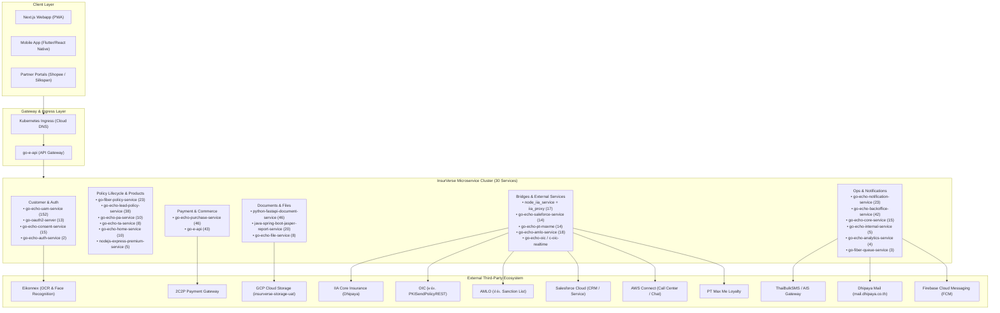

# ISV System Architecture: Complete API Inventory & Third-Party Integration Catalog

> **Authoritative Technical Blueprint**  
> **Environment:** InsurVerse ISV Platform (UAT-ISV / Production)  
> **Total Microservices:** 30 Microservices  
> **Total Unique API Endpoints:** ~596 Endpoints  
> **Total Third-Party Groups:** 11 External Provider Categories  
> **Last Verified:** September 2026  

---

## 📌 1. High-Level Architecture Topology

---

## 📌 2. Summary: API Endpoints Breakdown by Domain

| Domain | Microservices Included | Tech Stack | Total Endpoints | Key Responsibilities |
| :--- | :--- | :---: | :---: | :--- |
| **1. Customer Identity & Auth** | `go-echo-uam-service` `go-oauth2-server` `go-echo-consent-service` `go-echo-auth-service` | Go (Echo v4) Go OAuth2 | **182** | User profiles, authentication tokens, master geographical/vehicle data, eKYC card OCR, PDPA consent logs. |
| **2. Policy Lifecycle & Insurance** | `go-fiber-policy-service` `go-echo-lead-policy-service` `go-echo-pa-service` `go-echo-ta-service` `go-echo-home-service` `nodejs-express-premium-service` | Go (Fiber v2 / Echo v4) Node.js (Express) | **94** | Voluntary Motor (MV) & Compulsory Act (MC) issuance, PA, TA, Home policies, lead qualification, rating. |
| **3. Checkout & Payment** | `go-echo-purchase-service` `go-e-api` | Go (Echo v4) | **89** | Shopping cart, checkout orchestration, 2C2P payment gateway execution, payment callback verification. |
| **4. Document & Reporting** | `python-fastapi-document-service` `java-spring-boot-jasper-report-service` `go-echo-file-service` | Python (FastAPI) Java 17 (Spring Boot) Go (Echo v4) | **74** | Policy schedule PDFs, cryptographic digital signing, JasperReports tax receipts/invoices, GCS uploads. |
| **5. Core & External Integration** | `node_iia_service` + `iia_proxy` `go-echo-saleforce-service` `go-echo-pt-maxme` `go-echo-amlo-service` `go-echo-oic` / `c-oic-realtime` / `node-oic` | Node.js / Go / C | **64** | SOAP/WCF bridge to IIA core system, Salesforce CRM sync, PT Max Me loyalty points, AMLO anti-money laundering, OIC workers. |
| **6. Communication & Operations** | `go-echo-notification-service` `go-echo-backoffice-service` `go-echo-core-service` `go-echo-internal-service` `go-echo-analytics-service` `go-fiber-queue-service` | Go (Echo v4 / Fiber v2) | **93** | Multi-channel SMS/Email/Push dispatch, Admin Backoffice portal, metrics logging, asynchronous Redis queue workers. |
| **Grand Total** | **30 Microservices** | **Polyglot** | **~596** | **Complete ISV Microservice API Surface** |

---

## 📌 3. Detailed Microservice Inventory & Endpoints

| No. | Service Name | Language / Framework | Endpoints Count | Key Routes / Patterns | Primary Responsibility |
| :---: | :--- | :--- | :---: | :--- | :--- |
| **01** | `go-echo-uam-service` | Go (Echo v4) | **152** | `/api/v1/uam/*`, `/ocr_*`, `/get_user`, `/get_carband_all`, `/get_geo` | User profiles, OCR eKYC, Master Cars/Districts |
| **02** | `go-echo-purchase-service` | Go (Echo v4) | **46** | `/api/v1/purchase/*`, `/payment/2c2p/*`, `/payment/callback` | Cart checkout, 2C2P payment execution & status |
| **03** | `python-fastapi-document-service` | Python (FastAPI) | **46** | `/api/v1/document/pdf/*`, `/sign/*`, `/merge/*` | Policy PDF rendering, e-Signatures, watermarking |
| **04** | `go-e-api` | Go (Echo v4) | **43** | `/api/v1/gateway/*`, `/products/*`, `/quotation/*` | Public frontend API gateway & orchestration |
| **05** | `go-echo-backoffice-service` | Go (Echo v4) | **42** | `/api/v1/backoffice/*`, `/admin/*`, `/audit/*` | Admin portal, staff management, customer lookup |
| **06** | `go-echo-lead-policy-service` | Go (Echo v4) | **38** | `/api/v1/lead/*`, `/lead/convert`, `/policy/draft` | Prospect leads, quotation conversion |
| **07** | `go-echo-notification-service` | Go (Echo v4) | **23** | `/api/v1/notification/sms`, `/email`, `/fcm` | Dispatches SMS (TBS/AIS), Email (Dhipaya), Push |
| **08** | `go-fiber-policy-service` | Go (Fiber v2) | **23** | `/api/v1/policy/motor/*`, `/policy/detail`, `/cancel` | Motor insurance policies (MV & MC พ.ร.บ.) |
| **09** | `java-spring-boot-jasper-report-service` | Java (Spring Boot) | **20** | `/api/v1/jasper-report/*`, `/tax-invoice`, `/receipt` | Financial receipts, withholding tax, official PDFs |
| **10** | `go-echo-amlo-service` | Go (Echo v4) | **18** | `/api/v1/amlo/check`, `/amlo/sanctions` | AMLO (ปปง.) sanctions list verification |
| **11** | `node_iia_service` + `iia_proxy` | Node.js / Go | **17** | `/api/v1/iia/*`, `/WSToTemp.asmx`, `/Service1.svc` | SOAP proxy to IIA Core Insurance Backend |
| **12** | `go-echo-consent-service` | Go (Echo v4) | **15** | `/api/v1/consent/*`, `/pdpa/accept`, `/history` | PDPA legal consent records & versioning |
| **13** | `go-echo-core-service` | Go (Echo v4) | **15** | `/api/v1/core/*`, `/system/status` | Central system utilities & shared parameters |
| **14** | `go-echo-pt-maxme` | Go (Echo v4) | **14** | `/api/v1/pt/point/*`, `/maxme/redeem` | PT Max Card loyalty points accrual & redemption |
| **15** | `go-echo-saleforce-service` | Go (Echo v4) | **14** | `/api/v1/salesforce/sync/*`, `/lead`, `/case` | Salesforce synchronization adapter |
| **16** | `go-oauth2-server` | Go (Echo v4) | **13** | `/oauth/token`, `/oauth/authorize`, `/oauth/verify` | OAuth 2.0 Identity Server & Token Issuer |
| **17** | `go-echo-home-service` | Go (Echo v4) | **10** | `/api/v1/home/policy/*`, `/home/quotation` | Home & Property insurance policy management |
| **18** | `go-echo-pa-service` | Go (Echo v4) | **10** | `/api/v1/pa/policy/*`, `/pa/quotation` | Personal Accident (PA) insurance |
| **19** | `go-echo-file-service` | Go (Echo v4) | **8** | `/api/v1/file/upload`, `/download`, `/signed-url` | GCP Cloud Storage upload & signed URL broker |
| **20** | `go-echo-ta-service` | Go (Echo v4) | **8** | `/api/v1/ta/policy/*`, `/ta/quotation` | Travel Accident (TA) insurance |
| **21** | `nodejs-express-premium-service` | Node.js (Express) | **5** | `/api/v1/premium/calculate`, `/discount/apply` | Dynamic insurance premium rating engine |
| **22** | `go-echo-internal-service` | Go (Echo v4) | **5** | `/api/v1/internal/*`, `/batch/trigger` | Internal cron triggers & inter-service RPC |
| **23** | `go-echo-analytics-service` | Go (Echo v4) | **4** | `/api/v1/analytics/track`, `/event` | Customer journey event tracking & analytics |
| **24** | `go-fiber-queue-service` | Go (Fiber v2) | **3** | `/api/v1/queue/publish`, `/queue/status` | Redis / RabbitMQ asynchronous background queue |
| **25** | `go-echo-auth-service` | Go (Echo v4) | **2** | `/api/v1/auth/login`, `/auth/refresh` | Basic authentication endpoints |
| **26** | `go-echo-oic` | Go (Echo v4) | **1** | `/api/v1/oic/submit` | OIC regulatory payload submission endpoint |
| **27** | `nodejs-express-marketing-service`| Node.js (Express) | **1** | `/api/v1/marketing/campaign` | Marketing campaigns & promo code tracking |
| **28** | `c-oic-realtime` | C / Socket Worker | **0 (Daemon)** | Background Daemon / Socket Listener | Realtime socket worker forwarding MC to OIC |
| **29** | `node-oic` | Node.js Worker | **0 (Daemon)** | Background Queue Consumer | Asynchronous retry worker for OIC submissions |
| **30** | `go-echo-marketing-service` | Go (Echo v4) | **0 (Internal)**| Internal Event Handler | Partner referral & marketing events |

---

## 📌 4. Third-Party & External Integration Matrix (11 Categories)

### 4.1 Payment Gateway
* **Provider**: **2C2P (Thailand) Co., Ltd.**
* **Integration Protocols**: REST API, HMAC-SHA256 Signatures, Server-to-Server Webhooks.
* **Environment Targets**:
  - Sandbox: `https://demo2.2c2p.com/`
  - Production: `https://pgw.2c2p.com/`
* **Payment Channels**:
  - Credit / Debit Cards (VISA, MasterCard, JCB) with 3-D Secure (3DS).
  - PromptPay QR Code (Realtime dynamic QR with expiry).
  - Mobile Banking Deep Links (K-Plus, SCB Easy, BBL, Krungthai NEXT).
  - Interest-Free Installments (IPP 0% 3-10 months).
* **Consuming Service**: `go-echo-purchase-service`.

---

### 4.2 Core Insurance Backend
* **Provider**: **IIA (Dhipaya Insurance PCL Core System)**
* **Integration Protocols**: SOAP 1.1 / 1.2, WCF XML Web Services (`BasicHttpBinding`).
* **Endpoints**:
  - `WSToTemp.asmx`: Staging policy and lead data transfer.
  - `PolicyDataWS/Service1.svc`: Issuance inquiry, invoice status, endorsement verification.
* **Proxy Routing**:
  - Ingress via `iia-proxy-isv-service.insurverse.svc.cluster.local` (bridged via UAT node port forwarding to TIP Data Center IP `10.91.0.12`).
* **Consuming Services**: `node_iia_service`, `go-fiber-policy-service`, `go-echo-purchase-service`.

---

### 4.3 Government & Regulatory Authorities
1. **OIC (คปภ. - Office of Insurance Commission)**:
   - **Service**: Realtime PKI Compulsory Act (พ.ร.บ.) Insurance Reporting.
   - **Endpoint**: `http://35.240.226.193/oicrt/cmi/PKISendPolicyREST` / `10.91.0.6`
   - **Workers**: `c-oic-realtime`, `go-echo-oic`, `node-oic`.
2. **AMLO (ปปง. - Anti-Money Laundering Office)**:
   - **Service**: Counter-Terrorism and Proliferation Financing Sanction List.
   - **Integration**: REST API with API Key authentication (`Amlo_X_API_KEY`).
   - **Consuming Service**: `go-echo-amlo-service`.
3. **DOPA (กรมการปกครอง)**:
   - **Service**: Thai National ID verification & status inquiry (via eKYC Solution DIP Chip integration).

---

### 4.4 eKYC & Document OCR
* **Provider**: **Eikonnex (EKYC Solution Co., Ltd.)**
* **Endpoints**: `https://uat.ekycsolution.com/api/OCRService`
* **Capabilities**:
  - **Thai Citizen ID Card OCR**: Extracts 13-digit ID, Thai & English names, date of birth, address.
  - **Thai Driving License OCR**: Extracts license number, vehicle type, expiration date.
  - **Vehicle Registration Book (เล่มทะเบียนรถ) OCR**: Extracts chassis number, engine number, brand, model, license plate.
  - **Facial Recognition & Liveness**: Verifies selfie image against citizen ID photo.
* **Consuming Service**: `go-echo-uam-service`.

---

### 4.5 CRM & Service Cloud
* **Provider**: **Salesforce Cloud (SFDC)**
* **Integration Protocols**: OAuth 2.0 Client Credentials, Apex REST (`application/json`).
* **Interface Volume**: 72 Interfaces (detailed in `architecture/salesforce_api_specs/`).
* **Core Endpoints**:
  - `/services/apexrest/upsertlead`: Lead & prospect capture.
  - `/services/apexrest/upsertaccount`: Customer KYC account records.
  - `/services/apexrest/upsertpolicy`: Synchronizing policy documents and endorsements.
  - `/services/apexrest/paymentpremium`: Payment status & receipt attachments.
  - `/services/apexrest/upsertclaim`: Customer claim filings and damage assessment.
* **Consuming Service**: `go-echo-saleforce-service`.

---

### 4.6 Telephony & Contact Center
* **Provider**: **AWS Connect (Amazon Web Services)**
* **Capabilities**: Omni-channel contact center, inbound/outbound agent telephony, live chat routing, automated broadcast announcements.
* **Interfaces**: `AWS-Offline Message`, `AWS-BusinessHour`, `AWS-Boardcast`, `AWS-SendFile`.

---

### 4.7 SMS Messaging Gateways
1. **ThaiBulkSMS (TBS)**:
   - **Endpoint**: `https://api-v2.thaibulksms.com/sms`
   - **Use Case**: Primary high-speed SMS delivery for One-Time Passwords (OTP) and purchase notifications.
2. **AIS / TIP Corporate SMS Gateway**:
   - **Endpoint**: `http://110.49.202.49:10080`
   - **Use Case**: Internal enterprise secondary/failover SMS route.
* **Consuming Service**: `go-echo-notification-service`.

---

### 4.8 Email Delivery Systems
1. **Dhipaya Insurance Mail Server**:
   - **Host**: `mail.dhipaya.co.th:25` (Corporate SMTP).
   - **Use Case**: Official delivery of electronic policy schedules (e-Policy PDF), tax receipts, and legal notices.
2. **TBS Email API Gateway**:
   - **Endpoint**: `https://tbs-email-api-gateway.omb.to/email/v1/send_template`
   - **Use Case**: HTML templated marketing emails and system alerts.
* **Consuming Service**: `go-echo-notification-service`.

---

### 4.9 Mobile Push Notifications & Monitoring Alerts
1. **Google Firebase Cloud Messaging (FCM)**:
   - **SDK / Credentials**: Service account `firebase-adminsdk-yl57p@insurverse-app-63261.iam.gserviceaccount.com`.
   - **Use Case**: Push alerts to InsurVerse mobile application on iOS (APNs bridge) and Android devices.
2. **LINE Notify**:
   - **Use Case**: Internal operational alerts, database failover warnings, and error exception tracking for DevOps and engineering.

---

### 4.10 Cloud & Infrastructure Platform
* **Provider**: **Google Cloud Platform (GCP)**
* **Core Components**:
  - **Google Cloud Storage (GCS)**: Bucket `insurverse-storage-uat` storing policy PDFs, endorsements, claim photos, and garage bills.
  - **Google Kubernetes Engine (GKE) & Cloud Run**: Container orchestration hosting the 30 microservices and Next.js frontend.
  - **Google Secret Manager & Cloud KMS**: Secure encryption key storage and database credentials management.
  - **Google Cloud NAT**: Outbound static IP whitelist for secure access to IIA, OIC, and 2C2P.

---

### 4.11 Commercial Affinity & Partner Integrations
1. **PT Max Me (Max Card)**:
   - **Service**: `go-echo-pt-maxme`.
   - **Use Case**: Earning and redeeming PT Max Card loyalty points upon buying car insurance.
2. **Shopee Platform**:
   - **Use Case**: Embedded insurance sales, partner campaign tracking, voucher redemption.
3. **Silkspan**:
   - **Use Case**: Insurance broker aggregator lead acquisition and status callbacks.

---

## 📌 5. Environment Base URLs & Service Discovery

| Service Type | UAT-ISV Base URL | Production Base URL |
| :--- | :--- | :--- |
| **Public Frontend (PWA)** | `https://insurverse-uat-isv-app.insurverse.co.th` | `https://insurverse.co.th` |
| **API Gateway Ingress** | `https://insurverse-uat-isv-app.insurverse.co.th/api` | `https://insurverse.co.th/api` |
| **PostgreSQL Database** | `136.85.102.224:5432` (`insurverse`) | Managed Cloud SQL Instance |
| **IIA Proxy Service** | `http://iia-proxy-isv-service.insurverse.svc.cluster.local` | Direct VPC Interconnect to TIP DC |
| **OIC PKI Endpoint** | `http://35.240.226.193/oicrt/cmi/PKISendPolicyREST` | Production OIC Gateway |
