# UAT-ISV Database Schema Spec (`insurverse`)

- **Generated:** 2026-09-23
- **Source env:** UAT-ISV (read-only catalog introspection via `information_schema` / `pg_catalog`; no business rows read)
- **Row counts:** `pg_class.reltuples` estimates

## Files

- [insurverse_tables.md](insurverse_tables.md) — 300 tables
- [public_tables.md](public_tables.md) — 3 tables
- [functions_and_triggers.md](functions_and_triggers.md) — functions (advisory-lock flags), triggers, enums, views, sequences
- Function sources/backups: [../functions/README.md](../functions/README.md)

## Schemas

| Schema | Tables | Views | Functions | Sequences | Snapshot-looking tables |
|---|---|---|---|---|---|
| insurverse | 300 | 2 | 132 | 114 | 52 |
| public | 3 | 0 | 3 | 1 | 0 |

**Totals:** 303 tables, 2 views, 135 functions/procedures (6 using advisory locks), 5 triggers, 2 enums, 115 sequences, 9407 columns (incl. views).

## Relationships

Only **9 foreign keys** are declared in the database. Most relations between core tables are by **convention** (shared business keys such as `Policy_No`, `Lead_No`, `invoice_no`, `province_id`). Inferred links below come from matching a column name (ignoring case/underscores and `deli_`/`owner_`/`ref_` prefixes) to a single-column primary key of a non-snapshot table; `Policy_No`→`Policy_Header` and `Lead_No`→`Lead_coverage_premium` are pinned. **Inferred links are NOT enforced — verify before relying on them.**

### Declared foreign keys

| Table | Column(s) | → References | Constraint |
|---|---|---|---|
| callback_logs | `form_submission_id` | `insurverse.policy_form_submissions(id)` | callback_logs_form_submission_id_fkey |
| consent_content | `purposeId` | `insurverse.consent_purpose(id)` | FK_cd788b3c7101ff2e6ea304839d6 |
| email_logs | `api_key_id` | `insurverse.email_api_keys(id)` | fk_api_key |
| email_webhooks | `message_id` | `insurverse.email_logs(message_id)` | fk_message_id |
| lead_consent | `consent_id` | `insurverse.consent_marketing(id)` | lead_consent_consent_marketing_id_fk |
| log_activity | `activity_type_id` | `insurverse.activity_type(id)` | fk_activity_type |
| log_activity_ref | `log_activity_id` | `insurverse.log_activity(id)` | fk_log_activity |
| policy_form_submissions | `order_sn` | `insurverse.callback_logs(order_sn)` | policy_form_submissions_order_sn_fkey |
| tbl_blacklist | `request_id` | `insurverse.tbl_blacklist_request(request_id)` | tbl_blacklist_request_id_fkey |

### Inferred references by table

| Table | Column → Referenced table |
|---|---|
| act | `car_act_no` → Policy_Car_Act_Discount_Premium; `policy_no` → Policy_Header |
| Act_Renewal_Reminder | `Car_Act_Lead_No` → Lead_Car_Act_Discount_Premium |
| amlo_master | `COMP_CODE` → company_detail |
| api_flow_log | `lead_no` → Lead_coverage_premium |
| api_payload_logs | `lead_no` → Lead_coverage_premium; `payment_id` → payment; `policy_no` → Policy_Header; `ref_policy_no` → Policy_Header |
| batch_payment_errors | `ref_policy_no` → Policy_Header |
| callback_logs | `lead_no` → Lead_coverage_premium; `policy_no` → Policy_Header |
| consent_rop | `consent_accept_id` → consent_accept |
| ekyc_ocr | `lead_no` → Lead_coverage_premium; `policy_no` → Policy_Header |
| hbdisv_event | `policy_no` → Policy_Header |
| iia_commission | `partner_code` → mas_partner |
| iia_data_sr_claim_motor_movement | `dfpolicyno` → iia_data_sr_policy_daily_lastversion; `groupcode` → sec_group |
| iia_data_sr_claim_motor_movement_allocate_expense | `dfpolicyno` → iia_data_sr_policy_daily_lastversion; `groupcode` → sec_group |
| iia_data_sr_claim_nonmotor_movement | `dfpolicyno` → iia_data_sr_policy_daily_lastversion |
| iia_data_sr_motor_claim_lastversion | `dfpolicyno` → iia_data_sr_policy_daily_lastversion; `groupcode` → sec_group |
| iia_data_sr_nonmotor_claim_lastversion | `dfpolicyno` → iia_data_sr_policy_daily_lastversion |
| iia_data_sr_policy_daily | `dfpolicyno` → iia_data_sr_policy_daily_lastversion; `groupcode` → sec_group |
| iia_data_sr_policy_daily_lastversion | `groupcode` → sec_group |
| Imp_Discount_Premium | `Comp_Code` → company_detail |
| imp_discount_premium | `comp_code` → company_detail |
| Lead_Car_Act_Discount_Premium | `Comp_Code` → company_detail; `Deli_countryid` → mas_country; `Deli_district_id` → district; `Deli_province_id` → province; `Deli_subdistrict_id` → subdistrict; `Lead_No` → Lead_coverage_premium; `countryid` → mas_country; `district_id` → district; `partner_code` → mas_partner; `promo_trans_id` → promo_code_trans; `province_id` → province; `ref_policy_no` → Policy_Header; `subdistrict_id` → subdistrict |
| lead_consent | `lead_no` → Lead_coverage_premium |
| Lead_coverage_premium | `partner_code` → mas_partner; `promo_trans_id` → promo_code_trans; `ref_policy_no` → Policy_Header |
| lead_home_coverage | `policy_home_no` → policy_home_premium |
| lead_home_coverage_trans | `policy_home_no` → policy_home_premium |
| lead_home_participant | `owner_country_id` → mas_country; `owner_district_id` → district; `owner_province_id` → province; `owner_subdistrict_id` → subdistrict; `policy_home_no` → policy_home_premium |
| lead_home_participant_trans | `owner_country_id` → mas_country; `owner_district_id` → district; `owner_province_id` → province; `owner_subdistrict_id` → subdistrict; `policy_home_no` → policy_home_premium |
| lead_home_premium | `deli_district_id` → district; `deli_province_id` → province; `deli_subdistrict_id` → subdistrict; `home_building_type_id` → mas_home_building_type; `home_material_type_id` → mas_home_material_type; `home_resident_type_id` → mas_home_resident_type; `promo_trans_id` → promo_code_trans |
| lead_home_premium_tariff | `home_building_type_id` → mas_home_building_type; `home_coverage_id` → mas_home_coverage; `home_premium_tariff_id` → mas_home_premium_tariff; `policy_home_no` → policy_home_premium |
| lead_pa_beneficiary | `lead_pa_no` → lead_pa_premium; `policy_pa_no` → policy_pa_premium |
| lead_pa_beneficiary_trans | `lead_pa_no` → lead_pa_premium; `policy_pa_no` → policy_pa_premium |
| lead_pa_coverage | `lead_pa_no` → lead_pa_premium; `pa_coverage_id` → mas_pa_coverage; `policy_pa_no` → policy_pa_premium |
| lead_pa_coverage_trans | `lead_pa_no` → lead_pa_premium; `pa_coverage_id` → mas_pa_coverage; `policy_pa_no` → policy_pa_premium |
| lead_pa_participant | `lead_pa_no` → lead_pa_premium; `owner_country_id` → mas_country; `owner_district_id` → district; `owner_province_id` → province; `owner_subdistrict_id` → subdistrict; `policy_pa_no` → policy_pa_premium |
| lead_pa_participant_trans | `lead_pa_no` → lead_pa_premium; `owner_country_id` → mas_country; `owner_district_id` → district; `owner_province_id` → province; `owner_subdistrict_id` → subdistrict; `policy_pa_no` → policy_pa_premium |
| lead_pa_premium | `deli_district_id` → district; `deli_province_id` → province; `deli_subdistrict_id` → subdistrict; `pa_age_range_id` → mas_pa_age_range; `pa_occupation_id` → mas_pa_occupation; `pa_package_id` → mas_pa_package; `promo_trans_id` → promo_code_trans |
| lead_ta_package | `lead_ta_no` → lead_ta_premium; `policy_ta_no` → policy_ta_premium; `ta_package_id` → mas_ta_package |
| lead_ta_package_trans | `lead_ta_no` → lead_ta_premium; `policy_ta_no` → policy_ta_premium; `ta_package_id` → mas_ta_package |
| lead_ta_participant | `deli_district_id` → district; `deli_province_id` → province; `deli_subdistrict_id` → subdistrict; `lead_ta_no` → lead_ta_premium; `owner_country_id` → mas_country; `owner_district_id` → district; `owner_province_id` → province; `owner_state_id` → mas_state; `owner_subdistrict_id` → subdistrict; `policy_ta_no` → policy_ta_premium |
| lead_ta_participant_trans | `deli_district_id` → district; `deli_province_id` → province; `deli_subdistrict_id` → subdistrict; `lead_ta_no` → lead_ta_premium; `owner_country_id` → mas_country; `owner_district_id` → district; `owner_province_id` → province; `owner_subdistrict_id` → subdistrict; `policy_ta_no` → policy_ta_premium |
| lead_ta_premium | `deli_district_id` → district; `deli_province_id` → province; `deli_subdistrict_id` → subdistrict; `partner_code` → mas_partner; `promo_trans_id` → promo_code_trans; `ta_package_id` → mas_ta_package; `ta_travel_type_id` → mas_ta_travel_type |
| log_cmi_realtime | `car_act_no` → Policy_Car_Act_Discount_Premium; `policy_no` → Policy_Header |
| log_email_renewal | `policy_no` → Policy_Header |
| log_email_resend | `car_act_no` → Policy_Car_Act_Discount_Premium; `policy_no` → Policy_Header |
| log_emcs_claim | `car_act_no` → Policy_Car_Act_Discount_Premium; `policy_no` → Policy_Header |
| log_etax_trans | `car_act_no` → Policy_Car_Act_Discount_Premium; `policy_no` → Policy_Header |
| log_iia_policy | `car_act_no` → Policy_Car_Act_Discount_Premium; `policy_no` → Policy_Header |
| log_iia_policy_trans | `policy_no` → Policy_Header |
| log_noti_renewal | `policy_no` → Policy_Header |
| log_openapi_interface | `partner_code` → mas_partner |
| log_request_home | `policy_home_no` → policy_home_premium |
| log_request_pa | `policy_pa_no` → policy_pa_premium |
| log_request_ta | `policy_ta_no` → policy_ta_premium |
| log_sf_policy | `car_act_no` → Policy_Car_Act_Discount_Premium; `policy_no` → Policy_Header |
| log_sf_policy_trans | `car_act_no` → Policy_Car_Act_Discount_Premium; `deli_district_id` → district; `deli_province_id` → province; `deli_subdistrict_id` → subdistrict; `owner_district_id` → district; `owner_province_id` → province; `owner_subdistrict_id` → subdistrict; `package_id` → tqm_package_config; `policy_no` → Policy_Header |
| log_sf_policy_trans_request | `car_act_no` → Policy_Car_Act_Discount_Premium; `deli_district_id` → district; `deli_province_id` → province; `deli_subdistrict_id` → subdistrict; `owner_district_id` → district; `owner_province_id` → province; `owner_subdistrict_id` → subdistrict; `policy_no` → Policy_Header |
| log_tariff_renewal | `policy_no` → Policy_Header |
| log_workflow_process | `flow_process_id` → policy_workflow_process |
| loyalty_point_trans | `lead_no` → Lead_coverage_premium; `loyalty_con_id` → loyalty_condition; `policy_no` → Policy_Header; `promo_trans_id` → promo_code_trans |
| mas_cmi_province | `provinceid` → province |
| mas_home_coverage | `home_coverage_group_id` → mas_home_coverage_group |
| mas_home_premium_tariff | `home_building_type_id` → mas_home_building_type; `home_coverage_id` → mas_home_coverage |
| mas_home_province | `provinceid` → province |
| mas_state | `country_id` → mas_country |
| mas_ta_package | `ta_travel_type_id` → mas_ta_travel_type |
| mas_ta_package_coverage | `ta_coverage_id` → mas_ta_coverage; `ta_package_id` → mas_ta_package |
| mas_ta_premium | `ta_package_id` → mas_ta_package |
| payment | `lead_no` → Lead_coverage_premium |
| payment_ta | `lead_ta_no` → lead_ta_premium |
| payment_transaction | `lead_no` → Lead_coverage_premium |
| Policy_Car_Act_Discount_Premium | `Car_Act_Lead_No` → Lead_Car_Act_Discount_Premium; `Comp_Code` → company_detail; `Deli_countryid` → mas_country; `Deli_district_id` → district; `Deli_province_id` → province; `Deli_subdistrict_id` → subdistrict; `Lead_No` → Lead_coverage_premium; `Policy_No` → Policy_Header; `countryid` → mas_country; `district_id` → district; `par_id` → policy_participant; `partner_code` → mas_partner; `promo_trans_id` → promo_code_trans; `province_id` → province; `ref_policy_no` → Policy_Header; `subdistrict_id` → subdistrict |
| Policy_Car_Act_Discount_Premium_Trans | `Car_Act_Lead_No` → Lead_Car_Act_Discount_Premium; `Car_Act_No` → Policy_Car_Act_Discount_Premium; `Comp_Code` → company_detail; `Deli_countryid` → mas_country; `Deli_district_id` → district; `Deli_province_id` → province; `Deli_subdistrict_id` → subdistrict; `Lead_No` → Lead_coverage_premium; `Policy_No` → Policy_Header; `countryid` → mas_country; `district_id` → district; `par_id` → policy_participant; `partner_code` → mas_partner; `promo_trans_id` → promo_code_trans; `province_id` → province; `ref_policy_no` → Policy_Header; `subdistrict_id` → subdistrict |
| Policy_coverage_premium | `Lead_No` → Lead_coverage_premium; `Policy_No` → Policy_Header; `promo_trans_id` → promo_code_trans; `ref_policy_no` → Policy_Header |
| Policy_coverage_premium_Trans | `Lead_No` → Lead_coverage_premium; `Policy_No` → Policy_Header; `promo_trans_id` → promo_code_trans |
| Policy_email_confirm | `Car_Act_No` → Policy_Car_Act_Discount_Premium; `Policy_No` → Policy_Header; `policy_home_no` → policy_home_premium; `policy_pa_no` → policy_pa_premium; `policy_ta_no` → policy_ta_premium |
| Policy_endorse_detail | `Car_Act_No` → Policy_Car_Act_Discount_Premium; `Policy_No` → Policy_Header |
| Policy_Header | `Car_Act_No` → Policy_Car_Act_Discount_Premium; `Comp_Code` → company_detail; `Deli_countryid` → mas_country; `Deli_district_id` → district; `Deli_province_id` → province; `Deli_subdistrict_id` → subdistrict; `Lead_No` → Lead_coverage_premium; `Owner_countryid` → mas_country; `Owner_district_id` → district; `Owner_province_id` → province; `Owner_subdistrict_id` → subdistrict; `par_id` → policy_participant; `partner_code` → mas_partner |
| Policy_Header_Trans | `Car_Act_No` → Policy_Car_Act_Discount_Premium; `Comp_Code` → company_detail; `Deli_countryid` → mas_country; `Deli_district_id` → district; `Deli_province_id` → province; `Deli_subdistrict_id` → subdistrict; `Lead_No` → Lead_coverage_premium; `Owner_countryid` → mas_country; `Owner_district_id` → district; `Owner_province_id` → province; `Owner_subdistrict_id` → subdistrict; `Policy_No` → Policy_Header; `par_id` → policy_participant; `partner_code` → mas_partner; `ref_policy_no` → Policy_Header |
| policy_home_endorse_detail | `policy_home_no` → policy_home_premium |
| policy_home_premium | `deli_district_id` → district; `deli_province_id` → province; `deli_subdistrict_id` → subdistrict; `home_building_type_id` → mas_home_building_type; `home_material_type_id` → mas_home_material_type; `home_resident_type_id` → mas_home_resident_type; `promo_trans_id` → promo_code_trans |
| policy_home_premium_trans | `deli_district_id` → district; `deli_province_id` → province; `deli_subdistrict_id` → subdistrict; `home_building_type_id` → mas_home_building_type; `home_material_type_id` → mas_home_material_type; `home_resident_type_id` → mas_home_resident_type; `policy_home_no` → policy_home_premium; `promo_trans_id` → promo_code_trans |
| policy_no | `policy_no` → Policy_Header |
| policy_pa_endorse_detail | `policy_pa_no` → policy_pa_premium |
| policy_pa_premium | `deli_district_id` → district; `deli_province_id` → province; `deli_subdistrict_id` → subdistrict; `lead_pa_no` → lead_pa_premium; `pa_age_range_id` → mas_pa_age_range; `pa_occupation_id` → mas_pa_occupation; `pa_package_id` → mas_pa_package; `promo_trans_id` → promo_code_trans |
| policy_pa_premium_trans | `deli_district_id` → district; `deli_province_id` → province; `deli_subdistrict_id` → subdistrict; `lead_pa_no` → lead_pa_premium; `pa_age_range_id` → mas_pa_age_range; `pa_occupation_id` → mas_pa_occupation; `pa_package_id` → mas_pa_package; `policy_pa_no` → policy_pa_premium; `promo_trans_id` → promo_code_trans |
| Policy_Regis_Evident | `Policy_No` → Policy_Header |
| policy_ta_coverage | `policy_ta_no` → policy_ta_premium; `ta_coverage_id` → mas_ta_coverage; `ta_package_id` → mas_ta_package |
| policy_ta_coverage_trans | `policy_ta_no` → policy_ta_premium; `ta_coverage_id` → mas_ta_coverage; `ta_package_id` → mas_ta_package |
| policy_ta_endorse_detail | `policy_ta_no` → policy_ta_premium |
| policy_ta_premium | `deli_district_id` → district; `deli_province_id` → province; `deli_subdistrict_id` → subdistrict; `lead_ta_no` → lead_ta_premium; `partner_code` → mas_partner; `promo_trans_id` → promo_code_trans; `ta_package_id` → mas_ta_package; `ta_travel_type_id` → mas_ta_travel_type |
| policy_ta_premium_trans | `deli_district_id` → district; `deli_province_id` → province; `deli_subdistrict_id` → subdistrict; `lead_ta_no` → lead_ta_premium; `partner_code` → mas_partner; `policy_ta_no` → policy_ta_premium; `promo_trans_id` → promo_code_trans; `ta_package_id` → mas_ta_package; `ta_travel_type_id` → mas_ta_travel_type |
| promo_code | `promo_group_id` → promo_group |
| promo_code_trans | `promo_code_id` → promo_code |
| promo_condition | `promo_code_id` → promo_code |
| reconcile | `policy_no` → Policy_Header |
| renew_policy_records | `lead_no` → Lead_coverage_premium; `policy_no` → Policy_Header |
| renewal_payments | `ref_policy_no` → Policy_Header |
| sec_group_menu | `group_code` → sec_group; `menu_id` → sec_menu |
| sec_group_user | `group_code` → sec_group |
| sec_menu_scr | `menu_id` → sec_menu; `scr_id` → sec_screen |
| sec_user | `countryid` → mas_country; `district_id` → district; `province_id` → province; `subdistrict_id` → subdistrict |
| sec_user_sso | `countryid` → mas_country; `district_id` → district; `province_id` → province; `subdistrict_id` → subdistrict |
| sf_claim_car_detail | `policy_no` → Policy_Header |
| sys_param | `dom_code` → Sys_Domain |
| Sys_Sub_domain | `Dom_code` → Sys_Domain |
| tbl_blacklist_request | `blacklist_id` → tbl_blacklist |
| tqm_district | `district_id` → district |
| tqm_group_premium | `group_code` → sec_group |
| tqm_province | `province_id` → province |
| tqm_sub_district | `subdistrict_id` → subdistrict |
| zipcode | `districtid` → district; `provinceid` → province; `subdistrictid` → subdistrict |

### ER diagram — 25 most-connected tables

Solid line = declared FK; dotted = inferred by naming convention.

```mermaid
erDiagram
    Policy_Header {
        key Policy_No PK
    }
    province {
        key provinceid PK
    }
    district {
        key districtid PK
    }
    subdistrict {
        key subdistrictid PK
    }
    Policy_Car_Act_Discount_Premium {
        key Car_Act_No PK
    }
    mas_country {
        key country_id PK
    }
    Lead_coverage_premium {
        key Lead_No PK
    }
    policy_ta_premium {
        key policy_ta_no PK
    }
    policy_pa_premium {
        key policy_pa_no PK
    }
    promo_code_trans {
        key promo_trans_id PK
    }
    Lead_Car_Act_Discount_Premium {
        key Car_Act_Lead_No PK
    }
    policy_home_premium {
        key policy_home_no PK
    }
    lead_pa_premium {
        key lead_pa_no PK
    }
    lead_ta_premium {
        key lead_ta_no PK
    }
    mas_partner {
        key partner_code PK
    }
    mas_ta_package {
        key ta_package_id PK
    }
    log_sf_policy_trans {
        key id PK
    }
    company_detail {
        key comp_code PK
    }
    Lead_Car_Act_Discount_Premium }o..|| Lead_coverage_premium : "Lead_No"
    Lead_Car_Act_Discount_Premium }o..|| Policy_Header : "ref_policy_no"
    Lead_Car_Act_Discount_Premium }o..|| company_detail : "Comp_Code"
    Lead_Car_Act_Discount_Premium }o..|| district : "Deli_district_id"
    Lead_Car_Act_Discount_Premium }o..|| district : "district_id"
    Lead_Car_Act_Discount_Premium }o..|| mas_country : "Deli_countryid"
    Lead_Car_Act_Discount_Premium }o..|| mas_country : "countryid"
    Lead_Car_Act_Discount_Premium }o..|| mas_partner : "partner_code"
    Lead_Car_Act_Discount_Premium }o..|| promo_code_trans : "promo_trans_id"
    Lead_Car_Act_Discount_Premium }o..|| province : "Deli_province_id"
    Lead_Car_Act_Discount_Premium }o..|| province : "province_id"
    Lead_Car_Act_Discount_Premium }o..|| subdistrict : "Deli_subdistrict_id"
    Lead_Car_Act_Discount_Premium }o..|| subdistrict : "subdistrict_id"
    Lead_coverage_premium }o..|| Policy_Header : "ref_policy_no"
    Lead_coverage_premium }o..|| mas_partner : "partner_code"
    Lead_coverage_premium }o..|| promo_code_trans : "promo_trans_id"
    Policy_Car_Act_Discount_Premium }o..|| Lead_Car_Act_Discount_Premium : "Car_Act_Lead_No"
    Policy_Car_Act_Discount_Premium }o..|| Lead_coverage_premium : "Lead_No"
    Policy_Car_Act_Discount_Premium }o..|| Policy_Header : "Policy_No"
    Policy_Car_Act_Discount_Premium }o..|| Policy_Header : "ref_policy_no"
    Policy_Car_Act_Discount_Premium }o..|| company_detail : "Comp_Code"
    Policy_Car_Act_Discount_Premium }o..|| district : "Deli_district_id"
    Policy_Car_Act_Discount_Premium }o..|| district : "district_id"
    Policy_Car_Act_Discount_Premium }o..|| mas_country : "Deli_countryid"
    Policy_Car_Act_Discount_Premium }o..|| mas_country : "countryid"
    Policy_Car_Act_Discount_Premium }o..|| mas_partner : "partner_code"
    Policy_Car_Act_Discount_Premium }o..|| promo_code_trans : "promo_trans_id"
    Policy_Car_Act_Discount_Premium }o..|| province : "Deli_province_id"
    Policy_Car_Act_Discount_Premium }o..|| province : "province_id"
    Policy_Car_Act_Discount_Premium }o..|| subdistrict : "Deli_subdistrict_id"
    Policy_Car_Act_Discount_Premium }o..|| subdistrict : "subdistrict_id"
    Policy_Car_Act_Discount_Premium_Trans }o..|| Lead_Car_Act_Discount_Premium : "Car_Act_Lead_No"
    Policy_Car_Act_Discount_Premium_Trans }o..|| Lead_coverage_premium : "Lead_No"
    Policy_Car_Act_Discount_Premium_Trans }o..|| Policy_Car_Act_Discount_Premium : "Car_Act_No"
    Policy_Car_Act_Discount_Premium_Trans }o..|| Policy_Header : "Policy_No"
    Policy_Car_Act_Discount_Premium_Trans }o..|| Policy_Header : "ref_policy_no"
    Policy_Car_Act_Discount_Premium_Trans }o..|| company_detail : "Comp_Code"
    Policy_Car_Act_Discount_Premium_Trans }o..|| district : "Deli_district_id"
    Policy_Car_Act_Discount_Premium_Trans }o..|| district : "district_id"
    Policy_Car_Act_Discount_Premium_Trans }o..|| mas_country : "Deli_countryid"
    Policy_Car_Act_Discount_Premium_Trans }o..|| mas_country : "countryid"
    Policy_Car_Act_Discount_Premium_Trans }o..|| mas_partner : "partner_code"
    Policy_Car_Act_Discount_Premium_Trans }o..|| promo_code_trans : "promo_trans_id"
    Policy_Car_Act_Discount_Premium_Trans }o..|| province : "Deli_province_id"
    Policy_Car_Act_Discount_Premium_Trans }o..|| province : "province_id"
    Policy_Car_Act_Discount_Premium_Trans }o..|| subdistrict : "Deli_subdistrict_id"
    Policy_Car_Act_Discount_Premium_Trans }o..|| subdistrict : "subdistrict_id"
    Policy_Header }o..|| Lead_coverage_premium : "Lead_No"
    Policy_Header }o..|| Policy_Car_Act_Discount_Premium : "Car_Act_No"
    Policy_Header }o..|| company_detail : "Comp_Code"
    Policy_Header }o..|| district : "Deli_district_id"
    Policy_Header }o..|| district : "Owner_district_id"
    Policy_Header }o..|| mas_country : "Deli_countryid"
    Policy_Header }o..|| mas_country : "Owner_countryid"
    Policy_Header }o..|| mas_partner : "partner_code"
    Policy_Header }o..|| province : "Deli_province_id"
    Policy_Header }o..|| province : "Owner_province_id"
    Policy_Header }o..|| subdistrict : "Deli_subdistrict_id"
    Policy_Header }o..|| subdistrict : "Owner_subdistrict_id"
    Policy_Header_Trans }o..|| Lead_coverage_premium : "Lead_No"
    Policy_Header_Trans }o..|| Policy_Car_Act_Discount_Premium : "Car_Act_No"
    Policy_Header_Trans }o..|| Policy_Header : "Policy_No"
    Policy_Header_Trans }o..|| Policy_Header : "ref_policy_no"
    Policy_Header_Trans }o..|| company_detail : "Comp_Code"
    Policy_Header_Trans }o..|| district : "Deli_district_id"
    Policy_Header_Trans }o..|| district : "Owner_district_id"
    Policy_Header_Trans }o..|| mas_country : "Deli_countryid"
    Policy_Header_Trans }o..|| mas_country : "Owner_countryid"
    Policy_Header_Trans }o..|| mas_partner : "partner_code"
    Policy_Header_Trans }o..|| province : "Deli_province_id"
    Policy_Header_Trans }o..|| province : "Owner_province_id"
    Policy_Header_Trans }o..|| subdistrict : "Deli_subdistrict_id"
    Policy_Header_Trans }o..|| subdistrict : "Owner_subdistrict_id"
    lead_pa_premium }o..|| district : "deli_district_id"
    lead_pa_premium }o..|| promo_code_trans : "promo_trans_id"
    lead_pa_premium }o..|| province : "deli_province_id"
    lead_pa_premium }o..|| subdistrict : "deli_subdistrict_id"
    lead_ta_participant }o..|| district : "deli_district_id"
    lead_ta_participant }o..|| district : "owner_district_id"
    lead_ta_participant }o..|| lead_ta_premium : "lead_ta_no"
    lead_ta_participant }o..|| mas_country : "owner_country_id"
    lead_ta_participant }o..|| policy_ta_premium : "policy_ta_no"
    lead_ta_participant }o..|| province : "deli_province_id"
    lead_ta_participant }o..|| province : "owner_province_id"
    lead_ta_participant }o..|| subdistrict : "deli_subdistrict_id"
    lead_ta_participant }o..|| subdistrict : "owner_subdistrict_id"
    lead_ta_participant_trans }o..|| district : "deli_district_id"
    lead_ta_participant_trans }o..|| district : "owner_district_id"
    lead_ta_participant_trans }o..|| lead_ta_premium : "lead_ta_no"
    lead_ta_participant_trans }o..|| mas_country : "owner_country_id"
    lead_ta_participant_trans }o..|| policy_ta_premium : "policy_ta_no"
    lead_ta_participant_trans }o..|| province : "deli_province_id"
    lead_ta_participant_trans }o..|| province : "owner_province_id"
    lead_ta_participant_trans }o..|| subdistrict : "deli_subdistrict_id"
    lead_ta_participant_trans }o..|| subdistrict : "owner_subdistrict_id"
    lead_ta_premium }o..|| district : "deli_district_id"
    lead_ta_premium }o..|| mas_partner : "partner_code"
    lead_ta_premium }o..|| mas_ta_package : "ta_package_id"
    lead_ta_premium }o..|| promo_code_trans : "promo_trans_id"
    lead_ta_premium }o..|| province : "deli_province_id"
    lead_ta_premium }o..|| subdistrict : "deli_subdistrict_id"
    log_sf_policy_trans }o..|| Policy_Car_Act_Discount_Premium : "car_act_no"
    log_sf_policy_trans }o..|| Policy_Header : "policy_no"
    log_sf_policy_trans }o..|| district : "deli_district_id"
    log_sf_policy_trans }o..|| district : "owner_district_id"
    log_sf_policy_trans }o..|| province : "deli_province_id"
    log_sf_policy_trans }o..|| province : "owner_province_id"
    log_sf_policy_trans }o..|| subdistrict : "deli_subdistrict_id"
    log_sf_policy_trans }o..|| subdistrict : "owner_subdistrict_id"
    policy_home_premium }o..|| district : "deli_district_id"
    policy_home_premium }o..|| promo_code_trans : "promo_trans_id"
    policy_home_premium }o..|| province : "deli_province_id"
    policy_home_premium }o..|| subdistrict : "deli_subdistrict_id"
    policy_home_premium_trans }o..|| district : "deli_district_id"
    policy_home_premium_trans }o..|| policy_home_premium : "policy_home_no"
    policy_home_premium_trans }o..|| promo_code_trans : "promo_trans_id"
    policy_home_premium_trans }o..|| province : "deli_province_id"
    policy_home_premium_trans }o..|| subdistrict : "deli_subdistrict_id"
    policy_pa_premium }o..|| district : "deli_district_id"
    policy_pa_premium }o..|| lead_pa_premium : "lead_pa_no"
    policy_pa_premium }o..|| promo_code_trans : "promo_trans_id"
    policy_pa_premium }o..|| province : "deli_province_id"
    policy_pa_premium }o..|| subdistrict : "deli_subdistrict_id"
    policy_pa_premium_trans }o..|| district : "deli_district_id"
    policy_pa_premium_trans }o..|| lead_pa_premium : "lead_pa_no"
    policy_pa_premium_trans }o..|| policy_pa_premium : "policy_pa_no"
    policy_pa_premium_trans }o..|| promo_code_trans : "promo_trans_id"
    policy_pa_premium_trans }o..|| province : "deli_province_id"
    policy_pa_premium_trans }o..|| subdistrict : "deli_subdistrict_id"
    policy_ta_premium }o..|| district : "deli_district_id"
    policy_ta_premium }o..|| lead_ta_premium : "lead_ta_no"
    policy_ta_premium }o..|| mas_partner : "partner_code"
    policy_ta_premium }o..|| mas_ta_package : "ta_package_id"
    policy_ta_premium }o..|| promo_code_trans : "promo_trans_id"
    policy_ta_premium }o..|| province : "deli_province_id"
    policy_ta_premium }o..|| subdistrict : "deli_subdistrict_id"
    policy_ta_premium_trans }o..|| district : "deli_district_id"
    policy_ta_premium_trans }o..|| lead_ta_premium : "lead_ta_no"
    policy_ta_premium_trans }o..|| mas_partner : "partner_code"
    policy_ta_premium_trans }o..|| mas_ta_package : "ta_package_id"
    policy_ta_premium_trans }o..|| policy_ta_premium : "policy_ta_no"
    policy_ta_premium_trans }o..|| promo_code_trans : "promo_trans_id"
    policy_ta_premium_trans }o..|| province : "deli_province_id"
    policy_ta_premium_trans }o..|| subdistrict : "deli_subdistrict_id"
```

## Notes

- Many tables have dated suffixes (e.g. `_20260810`, `_bak_20260630`, `_12sep67`) — these appear to be manual snapshot/backup copies and are flagged *(snapshot?)* in the per-schema files.
- Advisory-lock users: `insurverse.fn_lead_to_car_act`, `insurverse.fn_policy_invoiceno_iia`, `insurverse.fn_policy_lotno_iia`, `insurverse.fn_policy_quatationno_iia`, `insurverse.fn_policy_to_car_act`, `public.fn_policy_advisory_lock` (see functions file).
