# 📄 ข้อเสนอและแผนงานจัดทำระบบ Client VPN บน GCP สำหรับทีมงาน
# Executive Proposal & Implementation Plan: GCP Client VPN Solution for Remote Team Access

---

## 📌 1. ภาพรวมและวัตถุประสงค์ / Executive Summary & Objective

**🇹🇭 ภาษาไทย**:
สืบเนื่องจากความต้องการในการให้พนักงานและทีมพัฒนาเข้าถึงทรัพยากรบนสภาพแวดล้อม **GCP (`vpc-uat-isv`)** จากภายนอกได้อย่างปลอดภัย เอกสารฉบับนี้ขอเสนอการติดตั้งระบบ **Client-to-Site VPN (Pritunl Solution)** เพื่อให้พนักงานแต่ละคนมี **Username / Password และ 2FA (MFA)** สำหรับยืนยันตัวตนรายบุคคล เพิ่มความปลอดภัยและเพิ่มความสะดวกในการบริหารจัดการสิทธิ์เข้าถึง

**🇬🇧 English**:
To enable secure remote access for developers and team members to internal GCP resources within **GCP (`vpc-uat-isv`)**, this proposal outlines the deployment of a **Client-to-Site VPN (Pritunl Solution)**. This setup provides individual **Username/Password credentials and 2FA (MFA)** per employee, enhancing network security, access auditing, and user management.

---

## 💰 2. การเปรียบเทียบและความคุ้มค่า / Cost & Solution Comparison

| รายการ / Item | รายละเอียด / Description | ค่าใช้จ่ายประมาณการ / Estimated Cost |
|---|---|---|
| **Software License** | Pritunl Free Edition (Unlimited Users, Open Source) | **$0 / เดือน (ฟรี)** |
| **GCP Compute Engine (VM)** | `e2-small` (2 vCPU, 2GB RAM - รองรับ 10–30 Users) | **~$13–$15 / เดือน** (~450–500 THB) |
| **Static Public IP** | 1 External IP Address | **~$2.5 / เดือน** (~90 THB) |
| **Network Egress** | Data Transfer Out | ตามจริง (~$0.12 / GB) |
| **รวมค่าใช้จ่ายทั้งหมด / Total** | **ครบจบในระบบเดียว ไม่จำกัดจำนวนผู้ใช้งาน** | **~500 – 1,000 บาท/เดือน ($15–$30 USD)** |

---

## 🛡️ 3. ฟีเจอร์หลักและความปลอดภัย / Key Features & Security Benefits

1. **Individual Authentication (สิทธิ์รายบุคคล)**:
   - ออก Username, Password และ 2FA (Google Authenticator) แยกให้พนักงานแต่ละคน
2. **Instant Revocation (ตัดสิทธิ์ได้ทันที)**:
   - เมื่อพนักงานลาออกหรือย้ายทีม สามารถกด Revoke / Disable บัญชีผ่าน Web UI ได้ทันที
3. **Strong Encryption (การเข้ารหัสความปลอดภัยสูง)**:
   - ใช้โปรโตคอลมาตรฐาน OpenVPN / WireGuard เข้ารหัสข้อมูล 100%
4. **VPC Network Isolation (การจำกัดขอบเขตเครือข่าย)**:
   - ควบคุมทราฟฟิกให้สิทธิ์เข้าถึงเฉพาะ VPC/Subnet ที่กำหนด (`vpc-uat-isv`) ผ่าน GCP Firewall Rules

---

## 💻 4. ชุดคำสั่งสำหรับการติดตั้งผ่าน `gcloud` CLI / CLI Implementation Commands

### Step 4.1: จอง Static Public IP Address
```bash
gcloud compute addresses create vpn-static-ip \
    --region=asia-southeast1
```

### Step 4.2: กำหนด Firewall Rules อนุญาตทราฟฟิก VPN & Web UI
```bash
# 1. อนุญาต Web UI Admin (HTTP/HTTPS)
gcloud compute firewall-rules create allow-vpn-webui \
    --direction=INGRESS \
    --priority=1000 \
    --network=vpc-uat-isv \
    --action=ALLOW \
    --rules=tcp:80,tcp:443 \
    --source-ranges=0.0.0.0/0 \
    --target-tags=vpn-server

# 2. อนุญาต UDP Ports สำหรับทราฟฟิก VPN
gcloud compute firewall-rules create allow-vpn-traffic \
    --direction=INGRESS \
    --priority=1000 \
    --network=vpc-uat-isv \
    --action=ALLOW \
    --rules=udp:1194,udp:13926 \
    --source-ranges=0.0.0.0/0 \
    --target-tags=vpn-server
```

### Step 4.3: สร้าง Compute Engine VM พร้อม Auto-Installer Script
```bash
gcloud compute instances create vpn-server-pritunl \
    --zone=asia-southeast1-a \
    --machine-type=e2-small \
    --network=vpc-uat-isv \
    --address=vpn-static-ip \
    --tags=vpn-server \
    --can-ip-forward \
    --image-family=ubuntu-2204-lts \
    --image-project=ubuntu-os-cloud \
    --boot-disk-size=20GB \
    --boot-disk-type=pd-balanced \
    --metadata=startup-script='#!/bin/bash
# Install MongoDB & Pritunl VPN Automatically
curl -fsSL https://www.mongodb.org/static/pgp/server-6.0.asc | sudo gpg --dearmor -o /etc/apt/trusted.gpg.d/mongodb-6.0.gpg
echo "deb [ arch=amd64,arm64 ] https://repo.mongodb.org/apt/ubuntu jammy/mongodb-org/6.0 multiverse" | sudo tee /etc/apt/sources.list.d/mongodb-org-6.0.list
curl -fsSL https://raw.githubusercontent.com/pritunl/pgp/master/pritunl.asc | sudo gpg --dearmor -o /etc/apt/trusted.gpg.d/pritunl.gpg
echo "deb https://repo.pritunl.com/stable/apt jammy main" | sudo tee /etc/apt/sources.list.d/pritunl.list
sudo apt-get update
sudo apt-get install -y mongodb-org pritunl
sudo systemctl start mongod pritunl
sudo systemctl enable mongod pritunl
'
```

### Step 4.4: ดึง Setup Key & Default Password
```bash
# ดึง Setup Key สำหรับเริ่มต้นสร้างระบบบน Web UI
gcloud compute ssh vpn-server-pritunl --zone=asia-southeast1-a --command="sudo pritunl setup-key"

# ดึง Default Credentials
gcloud compute ssh vpn-server-pritunl --zone=asia-southeast1-a --command="sudo pritunl default-password"
```

---

## 🗓️ 5. แผนการดำเนินงานและระยะเวลา / Implementation Timeline

**ระยะเวลาดำเนินการรวม (Total Estimated Time): 1 - 2 ชั่วโมง (Zero Downtime ต่อระบบเดิม)**

```mermaid
gantt
    title แผนงานการติดตั้ง GCP Client VPN (Pritunl)
    dateFormat  HH:mm
    axisFormat %H:%M
    section Phase 1: Provisioning via CLI
    Create Static IP & Firewall      :a1, 00:00, 15m
    Deploy VM via gcloud CLI         :a2, after a1, 15m
    section Phase 2: Configuration
    Pritunl & MongoDB Initial Setup :b1, after a2, 30m
    Configure VPC Routing & Ports    :b2, after b1, 15m
    section Phase 3: Onboarding
    Create Test Accounts & Profiles  :c1, after b2, 15m
    Testing & User Guide Distribution:c2, after c1, 30m
```



---

## 🎯 6. การประเมินความเสี่ยง / Risk Assessment

- **ผลกระทบต่อระบบปัจจุบัน**: **ไม่มี (Zero Impact)** เนื่องจากสร้างบน Compute Engine VM แยกต่างหาก ไม่กระทบกับ Workload หรือ GKE Cluster เดิม
- **การสำรองข้อมูล (Backup)**: สามารถทำ Automated Backup ไฟล์คอนฟิกของ Pritunl และ MongoDB ได้ง่าย
